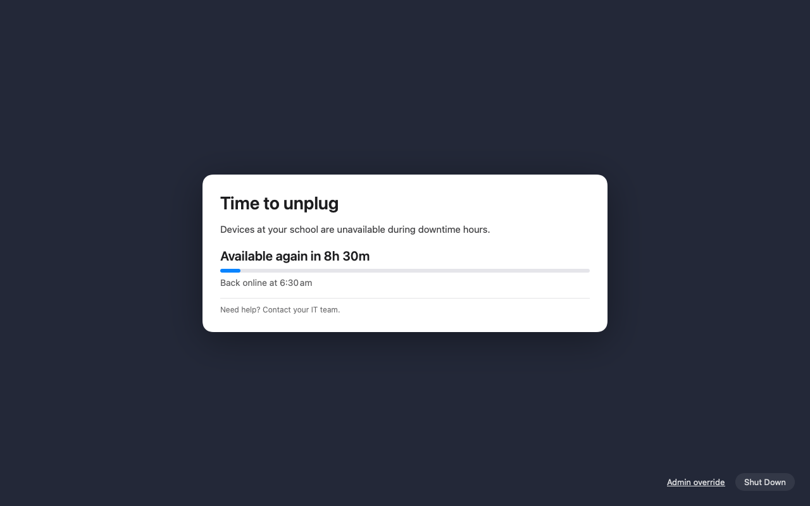
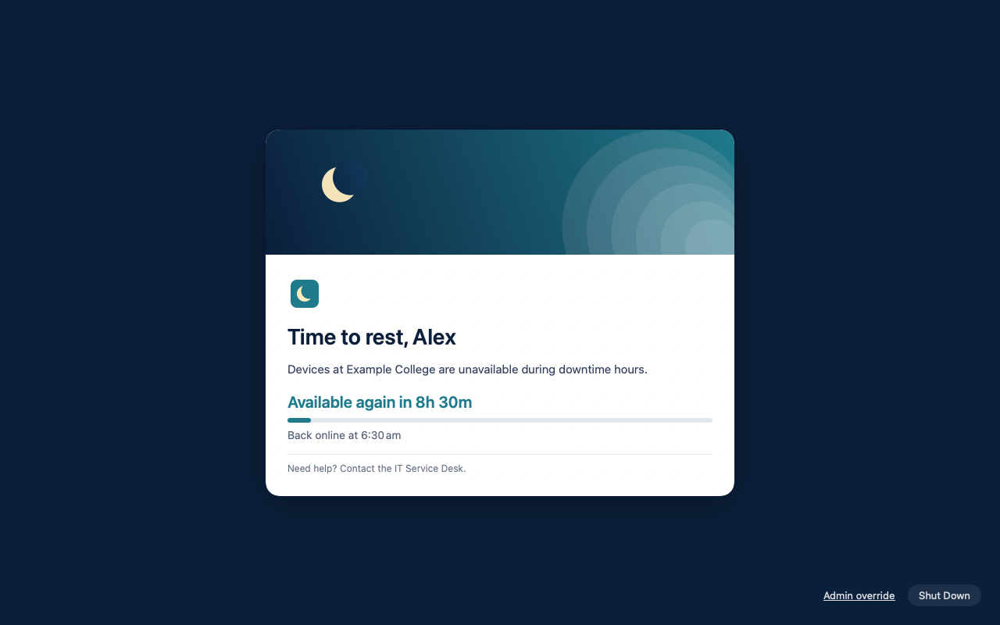
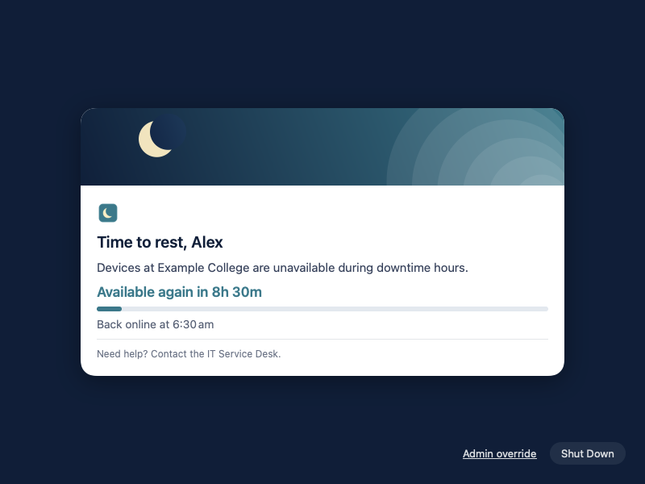
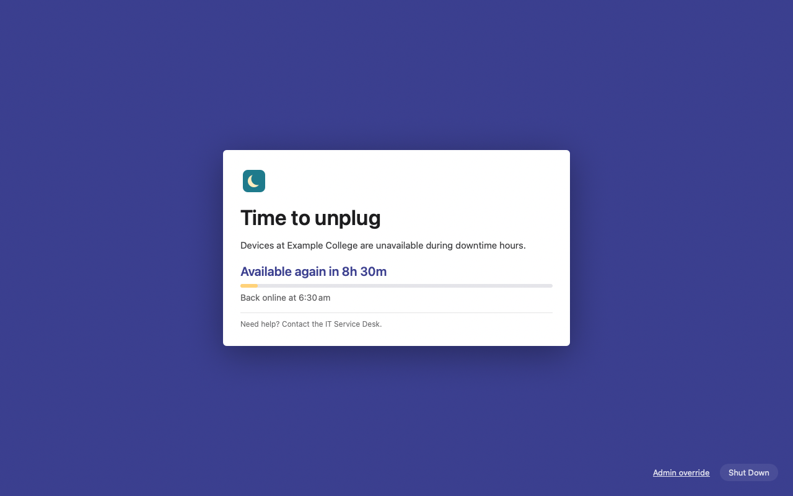
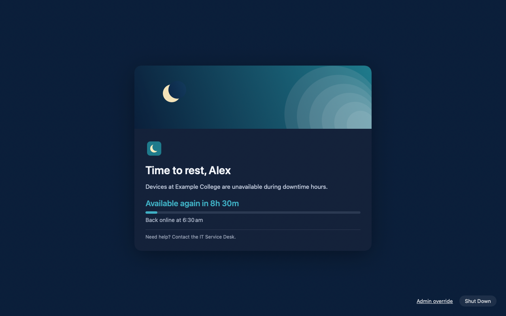
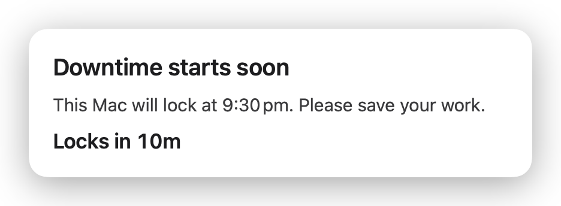
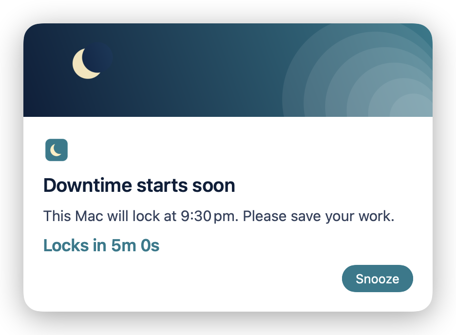
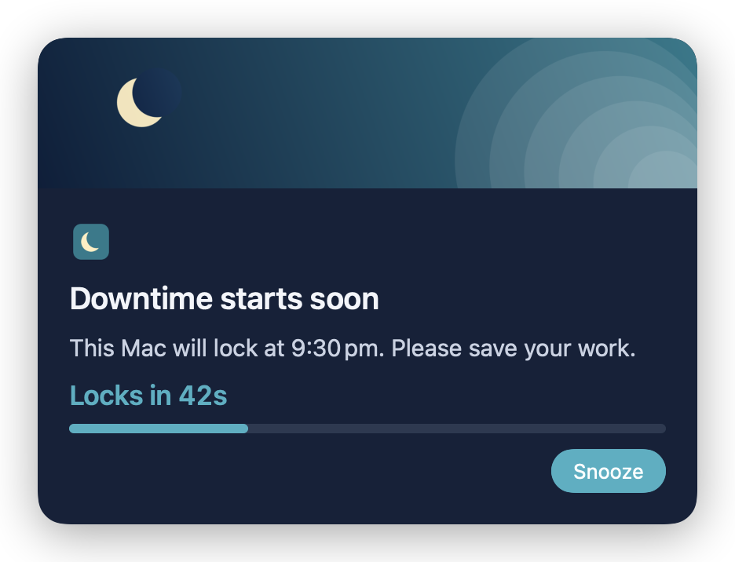
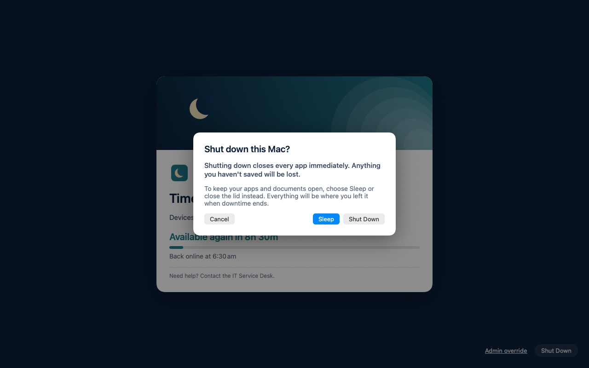

# Appearance guide

Make the lock screen and warning card look like your school: banner, logo,
colours, fonts, layout and every word on screen. All of it is in the
**Appearance** and **Texts** sections of the settings profile (see the
[Configuration guide](CONFIGURATION.md)). Anything you leave empty uses Lull's
default.

  
  

<em>Left: nothing configured. Right: banner, logo, colours, Organisation name, Support contact and a custom title.</em>

> On a Mac, the default **Blur** background shows the user's desktop, blurred
> and darkened. The screenshots show it as a plain dark colour.

- [The quickest win](#the-quickest-win)
- [Anatomy of the lock screen](#anatomy-of-the-lock-screen)
- [Background](#background) · [Images](#images) · [Colours and dark mode](#colours-and-dark-mode) · [Fonts and layout](#fonts-and-layout)
- [The warning card](#the-warning-card)
- [Wording](#wording)
- [Previewing your design](#previewing-your-design)
- [Examples](#examples)
- [Reference](#reference)

## The quickest win

Set two values in **Texts**:

- *Organisation name*: `Example College`
- *Support contact*: `the IT Service Desk (ext. 1234)`

The default messages use them: "Devices at **Example College** are unavailable
during downtime hours." and "Need help? Contact **the IT Service Desk (ext. 1234)**."
With neither set they read "Devices at your school…" and "Contact your IT team."

## Anatomy of the lock screen

From top to bottom, on the main display:

| Part | Settings |
|---|---|
| **Background** (every display) | *Background style*, *Background colour*, *Background opacity*, *Background image* |
| **Banner**: full width across the top of the card | *Banner image*, *Banner height*, *Banner scaling* |
| **Logo**: small, above the title | *Logo image* |
| **Title** | *Lock screen title*, *Title colour*, *Title font size* |
| **Message** | *Lock screen message*, *Body text colour*, *Body font size* |
| **Countdown**: "Available again in 8h 30m" | *Show countdown*, *Countdown colour* |
| **Progress bar**: how much of the downtime has passed | *Show progress bar*, *Accent colour*, *Progress track colour* |
| **Unlock label**: "Back online at 6:30 am" | *Unlock label* |
| **Support and footer** lines | *Support text*, *Footer* |
| **Card** around all of the above | *Card background colour*, *Card width*, *Card corner radius* |
| **Bottom-right controls** | *Override link label*, *Shut Down button label* (and *Show Shut Down button* in the Configuration guide) |

Other displays show the background only. On small screens the card switches
to a compact layout, and the support text always stays visible.

  

<em>The compact layout on a small screen.</em>

## Background

| *Background style* | Looks like | Uses |
|---|---|---|
| **Blur** (default) | The user's desktop, blurred, with a tint | *Background colour* as the tint, at *Background opacity* × 0.6 |
| **Solid** | A flat colour | *Background colour* at *Background opacity*. Set opacity to `1` to hide the desktop completely |
| **Image** | Your picture, filling the screen | *Background image*, darkened by *Background colour* at *Background opacity* × 0.4. If the file is missing, Blur is used; if it can't be decoded, a dark background |

  

<em>Solid background, no banner, logo only, a narrower card with square-ish corners and a larger title.</em>

With *Reduce transparency* turned on in the Mac's Accessibility settings, the
blur becomes opaque. That's expected.

## Images

Lull only loads images from **`/Library/Application Support/Lull/Branding/`**.
That folder is owned by root, so students can't replace your artwork. In the
profile, enter just the file name (`banner.png`) or the full path inside that folder.

**Getting images onto the Macs:** build a small package that installs them into
the Branding folder (Jamf Composer, or
`pkgbuild --root <folder> --install-location / branding.pkg`), and deploy it
with a policy. You can update artwork later by deploying a new package; no
profile change is needed if the file names stay the same.

| Image | Shown | Recommended file |
|---|---|---|
| **Banner** | Full width across the top of the card, *Banner height* points tall (default 180). **fill** crops to fill the area; **fit** shows the whole image | PNG or JPEG, about **1280 × 360 px** for the default card (twice the 640 × 180 point area, for Retina). Keep important content away from the edges if you use *fill* |
| **Logo** | Above the title, left-aligned, up to 44 points tall | PNG with a transparent background, about **88 px tall**. A wide wordmark is fine |
| **Background** | The whole screen, cropped to fill | JPEG, at least **2560 × 1600 px**. Busy images make the card harder to read; it's darkened by the background colour |

Limits: PNG, JPEG, HEIC, TIFF or GIF; at most **20 MB** and **8192 pixels** per
side. Missing, corrupt or oversized images are simply left out, so the lock
screen still works.

## Colours and dark mode

Colours are hex codes: `#1F7A8C`, `#FFF`, or with transparency `#1F7A8CCC`.

Every colour has an optional **dark mode** version (e.g. *Title colour (dark mode)*),
used when the Mac is in dark mode. If you only set the normal one, it's used in
both modes, so check your colours read well on a dark card too, or set both.

  
  

<em>The same profile in light and dark mode, with dark-mode colours set.</em>

**Contrast.** Students will read this at night in a dark room. Keep body text
dark on a light card (or light on a dark card), and check the countdown and
accent colours against the card background. Aim for a contrast ratio of at
least 4.5:1, which any online contrast checker can tell you.

## Fonts and layout

| Setting | Default | Notes |
|---|---|---|
| *Font* | System font (San Francisco) | The **PostScript name** of a font installed on the Macs, e.g. `AvenirNext-Regular`. Find it in Font Book (select the font, Info). Fonts you deploy go in `/Library/Fonts/`. An unknown name falls back to the system font |
| *Title font size* | 28 | 10–96 points. The title is semibold |
| *Body font size* | 15 | 8–64 points. The countdown, unlock label and footer scale from it |
| *Card width* | 640 | 320–1200 points. Never wider than the screen allows |
| *Card corner radius* | 16 | 0 (square) to 64 |
| *Show countdown*, *Show progress bar* | on | Turn off for a calmer screen |

## The warning card

A smaller card appears over whatever the student is doing, without taking
keyboard focus. By default it shows at 15, 10, 5, 2 and 1 minutes before the
lock, and stays up for the final 60 seconds with a countdown.

  
  
  

<em>Default; with banner and Snooze; final countdown in dark mode.</em>

It uses the same colours and fonts as the lock screen, with:

- *Warning card position*: **Top centre** (default), **Top right** or **Centre**
- *Show banner on warning card*: off by default; the banner is at most 96 points tall here
- At most 420 points wide; no support or footer lines
- A **Snooze** button when snooze is allowed (see the Configuration guide)

Timing (when the card appears, how long the final countdown is) is set in the
[Configuration guide](CONFIGURATION.md#warnings-and-snooze).

## Wording

Every message is editable in **Texts**. Leave a field empty to keep the
default. Messages can include **tokens**, which are filled in on screen:

| Token | Becomes | Example |
|---|---|---|
| `{{firstName}}` | The student's first name, from their account | Alex |
| `{{startTime}}` | When the lock starts (after any snooze) | 9:30 pm |
| `{{endTime}}` | When downtime ends | 6:30 am |
| `{{minutesRemaining}}` | Minutes until the next change, rounded up | 5 |
| `{{secondsRemaining}}` | Seconds until the next change | 42 |
| `{{scheduleName}}` | The schedule's *Name* | School night |
| `{{organizationName}}` | *Organisation name* | Example College |
| `{{supportContact}}` | *Support contact* | the IT Service Desk |

Times use the time zone in the profile and the student's own 12/24-hour preference.
A token Lull doesn't recognise is shown as typed, so typos are easy to spot.

| Text | Default |
|---|---|
| *Warning title* | Downtime starts soon |
| *Warning message* | This Mac will lock at {{startTime}}. Please save your work. |
| *Lock screen title* | Time to unplug |
| *Lock screen message* | Devices at {{organizationName}} are unavailable during downtime hours. |
| *Unlock label* | Back online at {{endTime}} |
| *Support text* | Need help? Contact {{supportContact}}. |
| *Footer* | (empty, not shown) |
| *Override link label* | Admin override |
| *Snooze button label* | Snooze |
| *Shut Down button label* | Shut Down |

The Shut Down confirmation and the admin override prompt use fixed wording. The
confirmation explains that unsaved work will be lost and suggests Sleep instead:

  

**Writing tips:** keep the title short and friendly; say *when* the Mac comes
back (the unlock label does this); always give students a way to get help
(support text). Avoid blaming language. Downtime is routine, not a punishment.

## Previewing your design

Use a **test Mac** with Lull installed and your profile scoped to it, and set a
schedule's *Start* a few minutes ahead. Then:

1. **Log in as a standard user.** Admin accounts are exempt by default, so
   you'd see nothing.
2. **Make sure you can get back in**: set an override passphrase (see the
   [Deployment guide](DEPLOYMENT.md#5-override-passphrase-optional)), and turn
   on Remote Login (SSH) so you can run
   `sudo "/Library/Application Support/Lull/bin/uninstall.sh"` from another
   computer if needed. Otherwise the Mac stays locked until downtime ends.
3. Watch the warning card, the final countdown and the lock screen, then
   unlock with the override. Profile changes apply within seconds of reaching
   the Mac, so you can adjust and look again.

## Examples

**Minimal, just your name and contact**

| Setting | Value |
|---|---|
| Texts › Organisation name | `Example College` |
| Texts › Support contact | `the IT Service Desk (ext. 1234)` |

**Fully branded** (the screenshots at the top)

| Setting | Value |
|---|---|
| Banner image / Logo image | `banner.png` / `logo.png` |
| Banner height | `180` |
| Background colour | `#0B1F3A` (opacity `0.7`) |
| Card background colour / dark | `#FFFFFF` / `#14223A` |
| Title colour / dark | `#0B1F3A` / `#F2F5FA` |
| Body text colour / dark | `#33415C` / `#C9D2E3` |
| Accent colour / dark | `#1F7A8C` / `#3FB0C4` |
| Countdown colour / dark | `#1F7A8C` / `#3FB0C4` |
| Progress track colour / dark | `#E1E8EF` / `#2B3A52` |
| Card width / corner radius | `600` / `18` |
| Show banner on warning card | on |
| Warning card position | Top right |
| Lock screen title | `Time to rest, {{firstName}}` |

`profiles/au.com.nickit.lull.mobileconfig` in the release's Jamf kit contains a complete branded example.

## Reference

### Appearance

| Key | Form label | Type | Default | Range / values |
|---|---|---|---|---|
| `BannerImagePath` | Banner image | file name | none | In the Branding folder |
| `BannerHeight` | Banner height (pt) | number | 180 | 0–600 |
| `BannerContentMode` | Banner scaling | `fill` \| `fit` | `fill` | |
| `LogoImagePath` | Logo image | file name | none | In the Branding folder |
| `BackgroundStyle` | Background style | `Blur` \| `Solid` \| `Image` | `Blur` | |
| `BackgroundColor` | Background colour | hex | `#000000` | |
| `BackgroundOpacity` | Background opacity | number | 0.85 | 0–1 |
| `BackgroundImagePath` | Background image | file name | none | In the Branding folder |
| `CardBackgroundColor` | Card background colour | hex | `#FFFFFF` (dark `#1C1C1E`) | |
| `CardCornerRadius` | Card corner radius | number | 16 | 0–64 |
| `CardWidth` | Card width (pt) | number | 640 | 320–1200 |
| `TitleColor` | Title colour | hex | `#1D1D1F` (dark `#F5F5F7`) | |
| `BodyColor` | Body text colour | hex | `#3A3A3C` (dark `#D1D1D6`) | |
| `AccentColor` | Accent colour | hex | `#0A84FF` | Progress bar, Snooze button |
| `CountdownColor` | Countdown colour | hex | `#1D1D1F` (dark `#F5F5F7`) | |
| `ProgressTrackColor` | Progress track colour | hex | `#E5E5EA` (dark `#3A3A3C`) | |
| `FontName` | Font | PostScript name | system | |
| `TitleFontSize` | Title font size | number | 28 | 10–96 |
| `BodyFontSize` | Body font size | number | 15 | 8–64 |
| `ShowCountdown` | Show countdown | bool | on | |
| `ShowProgress` | Show progress bar | bool | on | |
| `ShowBannerInWarning` | Show banner on warning card | bool | off | |
| `WarningCardPosition` | Warning card position | `TopCenter` \| `TopRight` \| `Center` | `TopCenter` | |

Each colour key also has a `…Dark` version (e.g. `TitleColorDark`) for dark
mode. Out-of-range numbers are clamped, and invalid colours or images fall back
to the default with a warning in `lullctl status`.

### Texts

| Key | Form label | Default |
|---|---|---|
| `OrganizationName` | Organisation name | your school |
| `SupportContact` | Support contact | your IT team |
| `WarningTitle` | Warning title | Downtime starts soon |
| `WarningMessage` | Warning message | This Mac will lock at {{startTime}}. Please save your work. |
| `LockedTitle` | Lock screen title | Time to unplug |
| `LockedMessage` | Lock screen message | Devices at {{organizationName}} are unavailable during downtime hours. |
| `UnlockLabel` | Unlock label | Back online at {{endTime}} |
| `FooterText` | Footer | (empty) |
| `SupportText` | Support text | Need help? Contact {{supportContact}}. |
| `OverrideButtonLabel` | Override link label | Admin override |
| `SnoozeButtonLabel` | Snooze button label | Snooze |
| `ShutdownButtonLabel` | Shut Down button label | Shut Down |
