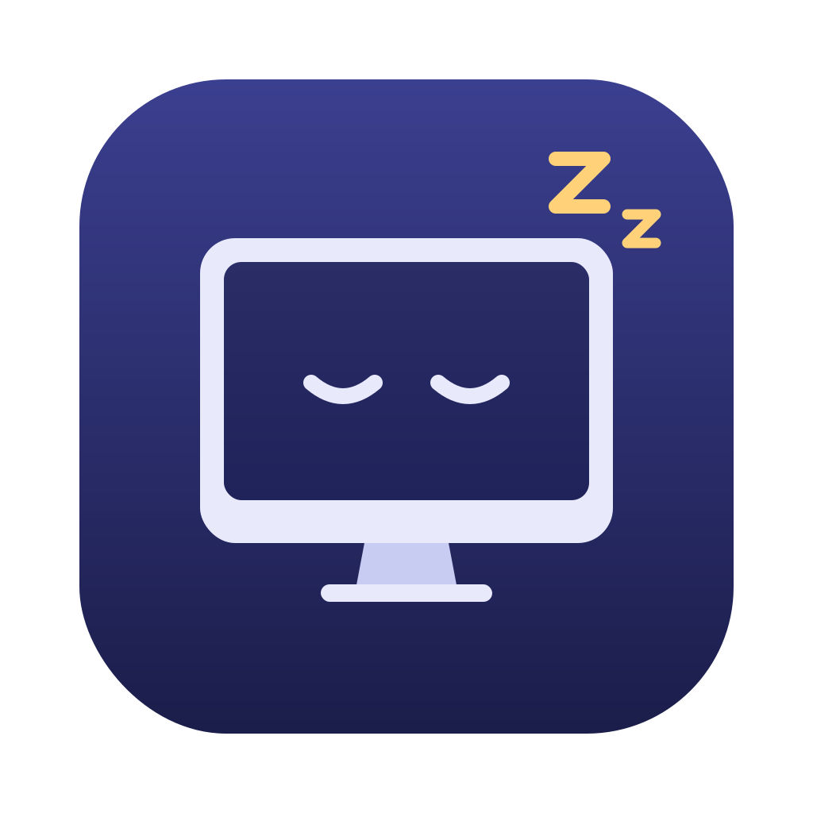
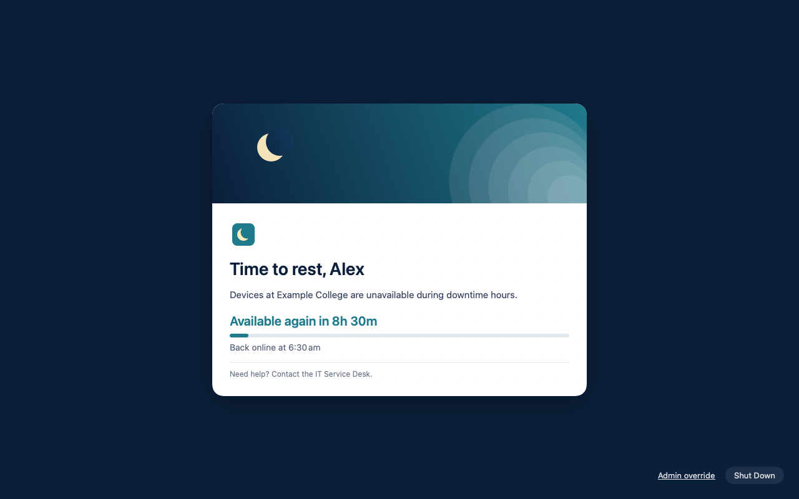

  

<h1 align="center">Lull</h1>

<strong>Scheduled device-free hours for school Macs.</strong>

Lull puts student Macs to rest at the times you choose. It warns students
before downtime starts, covers every display with a calm lock screen in your
school's branding, and gives the Mac back when downtime ends. You set it up
with a configuration profile from Jamf Pro, so nothing needs to be done on the
Mac itself.

  

## Features

- **Flexible schedules**: school nights, weekends, windows that run past
  midnight, school holidays and device-free days, all in your school's time
  zone, with daylight saving handled.
- **Warnings first**: a small card counts down to downtime, with an optional
  snooze.
- **Your branding**: banner, logo, colours, fonts and wording, in light and
  dark mode. The defaults look good with nothing set.
- **Hard to get around**: changing the clock or time zone, going offline,
  quitting or killing the lock screen don't work. Lull brings the lock screen
  back within seconds. [Security](SECURITY.md) lists what it resists, and its
  limits.
- **Never traps anyone**: the lock screen always shows who to contact and
  offers Shut Down or Sleep. Staff can unlock a Mac for a while with an admin
  passphrase.
- **Exemptions**: staff and admin accounts can be left alone.
- **Ready for Jamf Pro**: a signed and notarised installer, a custom schema for
  a form-based settings profile, and extension attributes to find Macs where
  Lull isn't healthy.
- **Optional parent portal**: with
  [lull-portal](https://github.com/nicholas-99w/lull-portal), parents can
  adjust evening and weekend times for their child's Mac, within limits you
  set. Without it, Lull needs no server.

## Requirements

- Macs with Apple silicon, running macOS 13 Ventura or later
- Jamf Pro, or another MDM that can deploy packages and configuration profiles
  (the form-based settings schema is specific to Jamf Pro)
- Students on standard (non-admin) accounts

## Getting started

1. Download the latest release from the [Releases page](../../releases/latest):
   the installer package and the Jamf kit.
2. Try it on a spare Mac with downtime set a few minutes ahead.
3. Deploy it with Jamf Pro: [Deployment guide](Docs/DEPLOYMENT.md).
4. Set your timetable: [Configuration guide](Docs/CONFIGURATION.md).
5. Make it look like your school: [Appearance guide](Docs/APPEARANCE.md).

## Documentation

| | |
|---|---|
| [Deployment guide](Docs/DEPLOYMENT.md) | Installing with Jamf Pro, rolling out, upgrading and removing |
| [Configuration guide](Docs/CONFIGURATION.md) | Schedules, holidays, warnings, exemptions and every other setting |
| [Appearance guide](Docs/APPEARANCE.md) | Branding and wording of the lock screen and warning card |
| [Security](SECURITY.md) | What Lull resists, its limits, and how to report a problem |
| [Testing](Docs/TESTING.md) | Test plan for a pilot Mac |
| [Development](Docs/DEVELOPMENT.md) | Building from source and how the code is laid out |
| [Changelog](Docs/CHANGELOG.md) | What changed in each release |

## How it works

Lull has three parts, installed together by one package:

- **`lulld`**, a background service running as root, reads the profile, keeps
  its own trusted time, and decides when to warn and lock.
- **`Lull.app`** runs for each logged-in user and shows the warning card and
  lock screen. If it's closed or killed, `lulld` brings it back.
- **`lullctl`** is a command-line tool for admins: `lullctl status` shows what
  Lull is doing and why, and `lullctl validate-config` checks a settings file
  before you deploy it.

## Licence

[MIT](LICENSE). Lull comes with no warranty: pilot it on a few Macs before
rolling it out.
